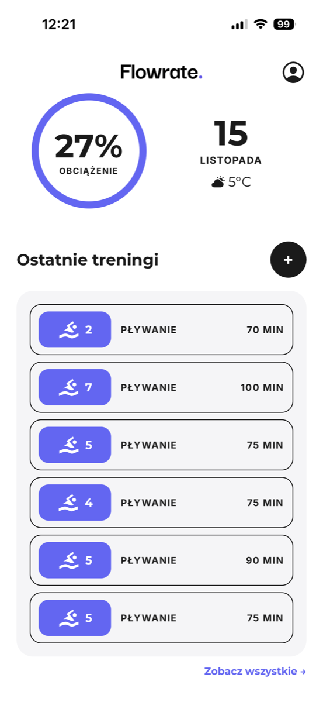
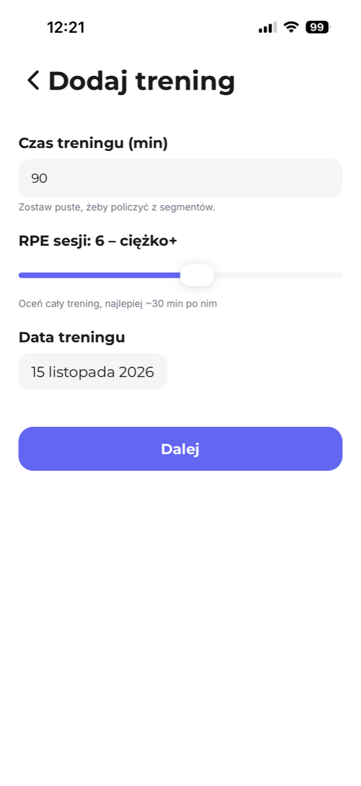
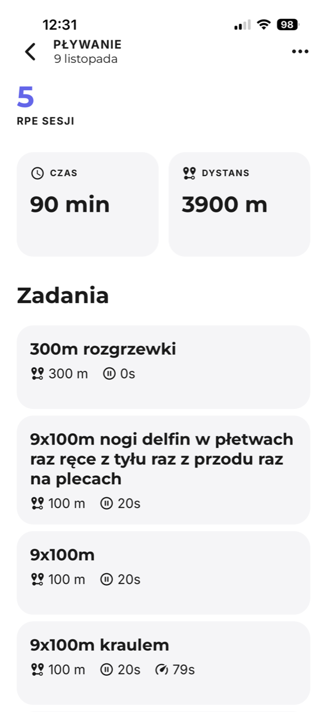

# Flowrate.

A training log for competitive swimmers that turns your sets into a single number: how loaded you are right now.

You log a session the way it was swum (tasks, repeats, rest, split times, RPE), and Flowrate estimates the training load of every set relative to **your own** speed profile. The home screen shows a load ring that rises with each session and fades over the following days.

<table align="center">
  <tr>
    <td align="center"><br><sub>Load ring</sub></td>
    <td align="center"><br><sub>Logging a session</sub></td>
    <td align="center"><br><sub>Session details</sub></td>
  </tr>
</table>

Built solo, from idea to TestFlight, in about three months. The app UI is in Polish.

> **Status:** beta on iOS via TestFlight. Public App Store release planned.

## Features

- **Detailed logging** – tasks (e.g. `8×100`) made of segments (e.g. `50 fast + 50 easy`), with an average time or every repeat's time, and segments without timing for kick, drills or other strokes.
- **Load ring** – a single percentage combining external load (from your times) and internal load (session-RPE), with 7-day decay, scaled to your own recent training.
- **Personal bests** – 50 / 100 / 200 / 400 m freestyle; the model is built on them.
- **Accounts** – email + password, each swimmer sees only their own data.
- **Weather** at the pool, from the phone's location.

## How the load model works

Most training-load tools for swimming rely on time × intensity. That treats a long easy session as harder than a short VO2max one. Flowrate tries to tell them apart:

| Element | Formula | Meaning |
|---|---|---|
| Critical speed (CS) | `200 / (t400 − t200)` | your aerobic threshold, from PBs |
| Intensity `I` | `segment speed / CS` | how fast compared to threshold |
| Reserve usage `X` | `(v − CS) / (v_PB − CS)`, clipped 0–1 | how much of your above-threshold "battery" the effort uses |
| Density `d` | `work / (work + rest)` | how short the rest was |

Segment load:

```
time × reps × I³ × (1 + 1.6·X² + 15·d⁵·X·(reps − 1)/reps)
```

- the `X²` term makes a single all-out effort expensive,
- the density term punishes repeating fast swimming with short rest, and only when swimming above threshold.

Session-RPE (`RPE × minutes`) is computed separately, so untimed work (kick, fins, drills) still counts. Both parts decay with `e^(−days / 7)`.

### Scaling the ring

100% is not a fixed number: it's your own recent hard period.

- **Peak** – for each of the last 42 days the app computes your decayed load on that day and takes the mean of the 5 highest. One exceptional day (a meet, a double session) doesn't set the scale on its own.
- **New users** – with little history the peak isn't reliable yet, so for the first 28 days it's blended with a default value: `w = days / 28`, `scale = w × peak + (1 − w) × default`.
- **Floor** – the scale never drops below 20% of the default, so someone who swims rarely doesn't hit 100% after one easy session.

External and internal load are scaled separately, and the ring is their average.

The model came from several iterations tested on real training sessions and grounded in critical speed research, swim TSS and session-RPE. Details live in [`backend/services/training_load.py`](backend/services/training_load.py) and its tests.

## Tech stack

| Part | Stack |
|---|---|
| Mobile app | React Native, Expo (SDK 57), Expo Router, TypeScript/JavaScript |
| Backend | Python 3.11, FastAPI, SQLite |
| Auth | bcrypt password hashing, JWT (PyJWT), token in iOS Keychain (`expo-secure-store`) |
| Tests | pytest |
| Hosting | Railway (backend + persistent volume for SQLite) |
| Builds | EAS Build / EAS Submit → TestFlight |
| Weather | Open-Meteo |

## Project structure

```
backend/
  main.py              FastAPI app, routers
  database.py          SQLite connection and schema
  routes/              HTTP endpoints (auth, trainings, personal bests, weather)
  repositories/        SQL queries
  services/            training load model, auth (hashing, JWT), weather
  models/              Pydantic models
  migrations/          one-off schema migrations
  scripts/             one-off maintenance scripts
  tests/               pytest
frontend/
  app/                 screens (Expo Router)
  api.js               fetch wrapper: token, timeout, 401 handling
  auth.js              token storage
  config.js            API address
  utils.js             parsing, formatting, shared helpers
```

## Running locally

### Backend

```bash
python -m venv .venv
source .venv/bin/activate
pip install -r requirements.txt

export FLOWRATE_SECRET_KEY="$(python -c 'import secrets; print(secrets.token_hex(32))')"
uvicorn backend.main:app --host 0.0.0.0
```

- The server will not start without `FLOWRATE_SECRET_KEY` (used to sign tokens).
- The database defaults to `flowrate_dev.db` in the project root. Set `FLOWRATE_DB` to use another file (an absolute path is used as is).
- API docs: `http://localhost:8000/docs`.

Tests:

```bash
python -m pytest
```

### Mobile app

```bash
cd frontend
npm install
npx expo start
```

Point `API_URL` in `frontend/config.js` at your backend.

## Roadmap

- Android version (Google Play), then App Store release,
- account deletion, password reset and email verification,
- strength sessions, competitions, trend charts.

## Author

Built by [@johnnycodepoland](https://github.com/johnnycodepoland), a competitive swimmer who wanted to know how hard his training really is.

© 2026 johnnycodepoland. All rights reserved.